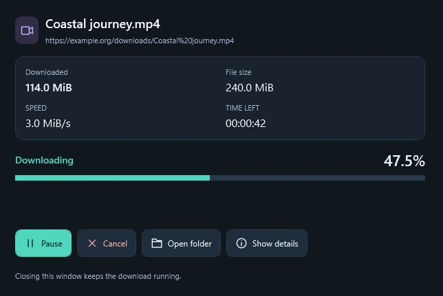
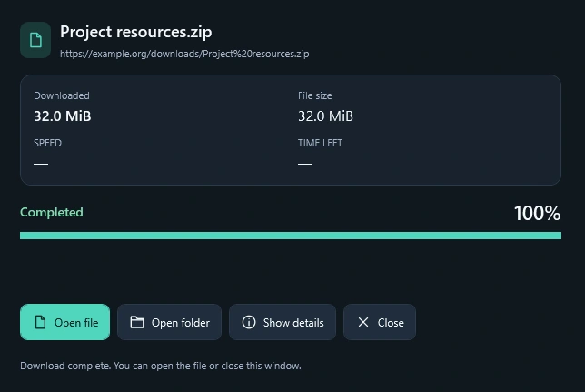

  <picture>
    <source media="(prefers-color-scheme: dark)" srcset=".github/assets/logo-dark.svg">
    <source media="(prefers-color-scheme: light)" srcset=".github/assets/logo-light.svg">
    
  </picture>
  <h1>GrabThis Download Manager</h1>
  
<strong>Faster downloads. Less clutter.</strong> Files, videos and MP3, with the essential tools in one straightforward app.

  

    
    
  

  

  
Free to use · Light &amp; dark · English / Français / العربية

  
<a href="#screenshots">Screenshots</a> · <a href="#installation">Installation</a> · <a href="docs/BROWSER-SETUP.md">Extension setup</a> · <a href="#help-and-feedback">Help</a>

<picture>
  <source media="(prefers-color-scheme: dark)" srcset=".github/assets/app-dark.webp">
  <source media="(prefers-color-scheme: light)" srcset=".github/assets/app-light.webp">
  
</picture>

## The essentials, without the clutter

- ⚡ **Faster downloads** — download file parts in parallel with up to 8 connections on supported servers.
- 🌐 **Capture browser downloads** — send eligible files straight to GrabThis.
- 🎬 **Choose video quality** — use the floating button to pick available MP4 or MP3 options.
- ⏯️ **Pause and resume** — continue supported downloads and control their speed.
- 🎵 **Convert video to MP3** — turn a local video into audio while keeping the original.
- 🗂️ **Keep downloads organized** — categories, search and multiple selection in one library.

Parallel connections help make better use of your available bandwidth. Actual speed depends on your connection and the server.

## Screenshots

### Follow your download

See progress, speed and time remaining in a separate window. Closing the window keeps the download running.

<picture>
  <source media="(prefers-color-scheme: dark)" srcset=".github/assets/download-active-dark.webp">
  <source media="(prefers-color-scheme: light)" srcset=".github/assets/download-active-light.webp">
  
</picture>

### Ready when it finishes

Open the file or its folder directly from the completed download window.

<picture>
  <source media="(prefers-color-scheme: dark)" srcset=".github/assets/download-completed-dark.webp">
  <source media="(prefers-color-scheme: light)" srcset=".github/assets/download-completed-light.webp">
  
</picture>

Desktop screenshots show the actual interface with example data. [Screenshot notes and credits](docs/SCREENSHOTS.md).

### Choose formats right on the video

The floating button offers the formats available for the selected video. Here is the quality menu up close:

| YouTube | Instagram | TikTok |
| --- | --- | --- |
|  |  |  |

Formats depend on the source. YouTube focuses on the main video; on other supported pages, click to inspect the selected video. MP3 conversion runs in the desktop app.

**Hide it when you want:** hover over the floating button and click **×** to hide it for that video. Refresh the page to bring it back.

## Installation

1. **[Download the Windows installer](https://github.com/Godchi872/GrabThis/releases/download/v0.1.48/GrabThis-0.1.48-Setup.exe)**, open it and approve the Windows prompt.
2. **Launch GrabThis** from the Desktop or Start Menu.
3. **Follow Extension setup** on first launch to connect your browser.

No terminal or .NET installation is needed. Setup prepares the video tools automatically and needs an internet connection. [Installation details and updates →](docs/INSTALLATION.md)

### Connect your browser

| Chrome · Edge · Brave · Opera | Firefox |
| --- | --- |
| Load the included extension with Developer mode. | Open the Firefox Add-ons listing. |
| **[Illustrated setup guide →](docs/BROWSER-SETUP.md#chromium-browsers)** | **[Firefox Add-ons →](https://addons.mozilla.org/en-US/firefox/addon/grabthis-download-companion/)** · [Help](docs/BROWSER-SETUP.md#firefox) |

The Chromium guide highlights each control to click. You can reopen **Extension setup** from GrabThis’s sidebar at any time. Firefox listing availability is managed by Mozilla.

## Help and feedback

- **[Report a bug](https://github.com/Godchi872/GrabThis/issues/new/choose)** or suggest a feature.
- **[Extension troubleshooting](docs/BROWSER-SETUP.md#troubleshooting)** for connection and capture issues.
- **[Installation and update help](docs/INSTALLATION.md)** for setup, updates and uninstalling.

Download compatibility and how GrabThis stays open

Resume and available formats depend on the source. Some signed-in downloads, including eligible Google Drive folder ZIPs, use your browser session while GrabThis saves the file. Keep that browser open during these downloads. Protected content, POST, blob and unsupported browser sessions may remain in the browser.

Closing the main window hides GrabThis in the notification area so downloads can continue. Choose **Exit** from its tray menu to quit.

## Support GrabThis

GrabThis is free to use. Donations help support its development.

---

This repository hosts official downloads, documentation and issue tracking. Desktop source is maintained separately. Third-party license notices are included with the app. The current downloadable app is for Windows x64.

[Website](https://grabthis.vercel.app/) · [Privacy](https://grabthis.vercel.app/privacy/) · [Changelog](CHANGELOG.md) · [Latest release](https://github.com/Godchi872/GrabThis/releases/latest)
