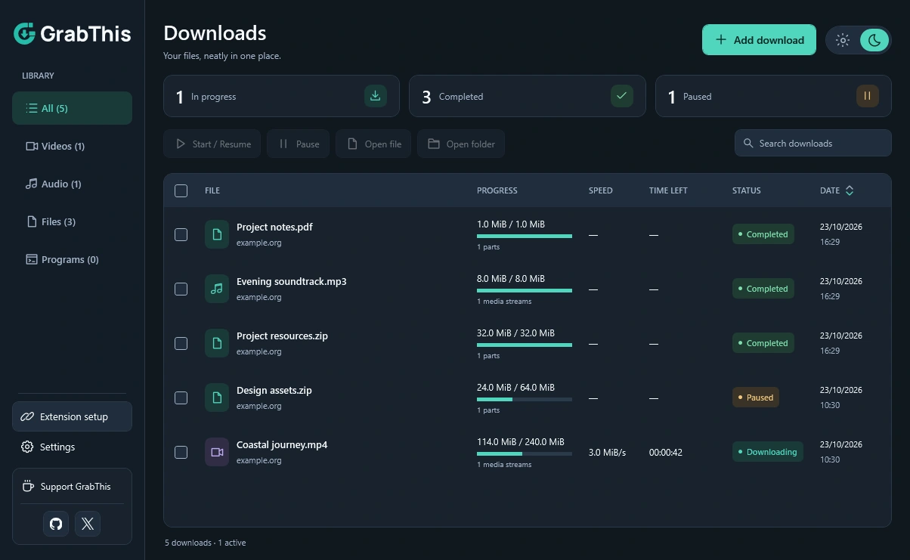
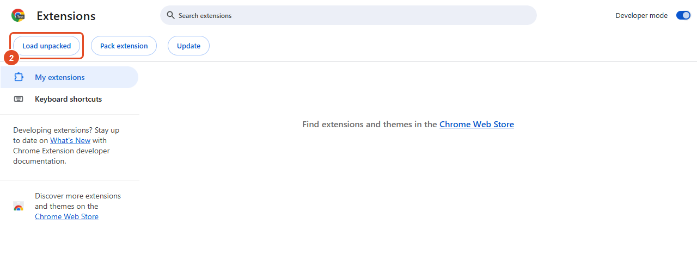
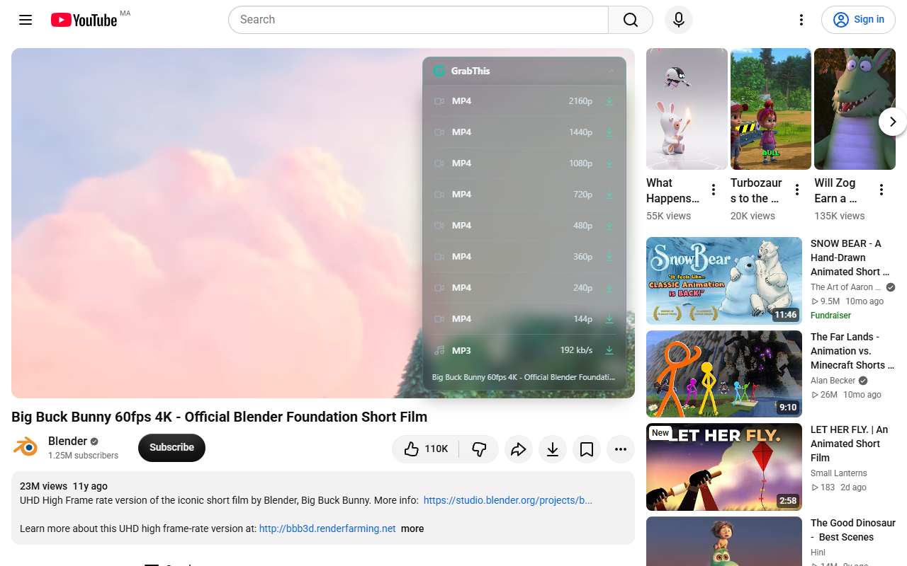
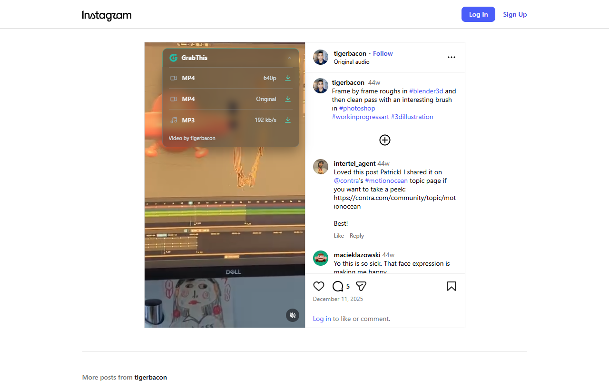
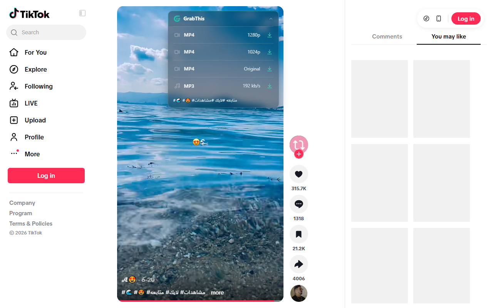
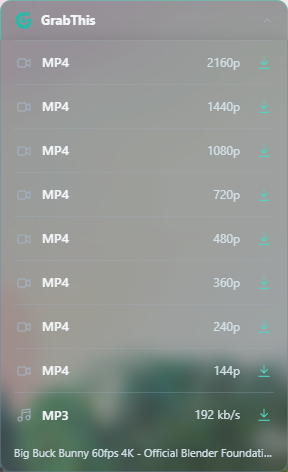
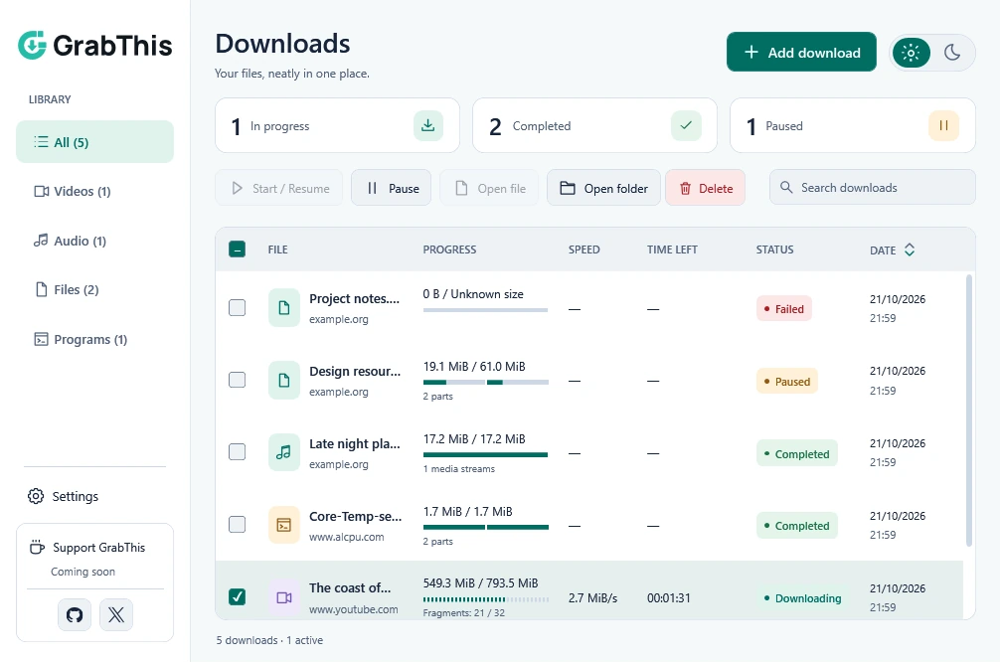

  <picture>
    <source media="(prefers-color-scheme: dark)" srcset=".github/assets/logo-dark.svg">
    <source media="(prefers-color-scheme: light)" srcset=".github/assets/logo-light.svg">
    
  </picture>
  <h1>GrabThis Download Manager</h1>
  
<strong>Your downloads. Under control.</strong> Files, video and MP3 — the tools you need in one straightforward app.

  
<a href="https://github.com/Godchi872/GrabThis/releases/download/v0.1.40/GrabThis-0.1.40-Setup.exe"><strong>Download for Windows</strong></a> · <a href="https://grabthis.vercel.app/">Website</a> · <a href="docs/BROWSER-SETUP.md">Browser setup</a> · <a href="#screenshots">Screenshots</a>

  
Free to use &nbsp; · &nbsp; Windows x64 &nbsp; · &nbsp; English / Français / العربية

<picture>
  <source media="(prefers-color-scheme: dark)" srcset=".github/assets/app-dark.webp">
  <source media="(prefers-color-scheme: light)" srcset=".github/assets/app-light.webp">
  
</picture>

## What you can do

| Tool | What it does |
| --- | --- |
| **Capture browser downloads** | Send eligible HTTP(S) files to GrabThis, with Start, Cancel and Download in browser choices. |
| **Choose video formats** | A floating button gives you the available MP4 and MP3 options for the current video. |
| **Stay in control** | Pause and resume supported downloads, manage connections, and set a speed limit. |
| **Convert video to MP3** | Convert a local video inside the app while keeping the original file. |
| **Keep things organized** | Categories, search, date sorting and multiple selection for your library. |
| **Update inside the app** | Automatic update checks, direct installer download with progress, and SHA-256 verification before installation. |
| **Make it yours** | Light/dark appearance, three languages, completion notifications and tray controls. |

## Install in a few clicks

1. Download **[GrabThis-0.1.40-Setup.exe](https://github.com/Godchi872/GrabThis/releases/download/v0.1.40/GrabThis-0.1.40-Setup.exe)** and open it.
2. Choose the installation folder. Setup prepares the video tools and browser connection automatically. An internet connection is needed for about 105 MB of verified tools.
3. Open **GrabThis** from the Desktop or Windows Start Menu shortcut.
4. Follow the **Browser setup** wizard that opens on first launch. Choose your browser and follow its annotated screenshots. You can reopen it from the sidebar at any time; an [illustrated web guide](docs/BROWSER-SETUP.md) is also available.

No terminal, administrator account or .NET SDK is required. The installer is an unsigned preview. [Release notes and checksums](https://github.com/Godchi872/GrabThis/releases/tag/v0.1.40) are available with the download. Choose **Setup.exe**, rather than GitHub’s automatically generated Source code archives.

From version **0.1.38**, GrabThis checks for updates at startup and every six hours. Use the update banner or **Settings → Check for updates** to download the installer inside the app, then choose **Install update**. Older versions need one manual Setup installation.

## Add the browser companion

Both extension folders are installed beside the app. **Start Menu → GrabThis → Browser extensions** opens the Chromium extension folder.

| Chrome / Edge / Brave / Opera | Firefox |
| --- | --- |
| Enable Developer mode, click Load unpacked, and select **extension**. | The included **extension-firefox** folder is a temporary development preview. Permanent installation requires the signed store version. |
| [Four steps with highlighted screenshots →](docs/BROWSER-SETUP.md#chromium-browsers) | [Firefox instructions →](docs/BROWSER-SETUP.md#firefox) |

Companion version: **0.1.23**. Setup registers the desktop connection automatically; installing the extension in each browser still requires your approval.

## Screenshots

### A floating button on your video

These images show the real GrabThis companion on public videos, with formats returned by the desktop app. Click an image to view it at full size.

| YouTube | Instagram | TikTok |
| --- | --- | --- |
|  |  |  |
| Automatically prepares formats for the main video. | Click to inspect the current Reel. | Click to inspect the chosen video, without fetching the whole feed. |

<strong>See the available video qualities up close</strong>

These qualities belong to this example video. Available formats depend on the source; MP3 conversion is performed by the desktop app.

<strong>See the light appearance</strong>

[Screenshot sources and credits](docs/SCREENSHOTS.md)

## Help and feedback

- **[Report a bug](https://github.com/Godchi872/GrabThis/issues/new/choose)** with your app/companion versions and steps to reproduce it.
- **Desktop app disconnected?** Open GrabThis, run Setup again to repair the connection, then reload the extension. [More help](docs/BROWSER-SETUP.md#troubleshooting).
- **Window X:** hides GrabThis in the notification area. Choose Exit from the tray menu to quit.

Formats and resume support depend on the source. Protected, login-only, POST, blob and browser-only sessions may be unavailable or remain in the browser. Uninstalling preserves download history, preferences and downloaded files.

## Support GrabThis

GrabThis is free to use. You can **[support its development](https://ko-fi.com/grabthis)** if it helps you.

---

This repository hosts official release downloads, documentation and issue tracking. Desktop source is maintained separately. Third-party tools retain their own licenses; runtime notices are included with the app, and Setup downloads video tools from their upstream releases. The current downloadable app is for Windows x64.

[Website](https://grabthis.vercel.app/) · [Privacy](https://grabthis.vercel.app/privacy/) · [Changelog](CHANGELOG.md)
