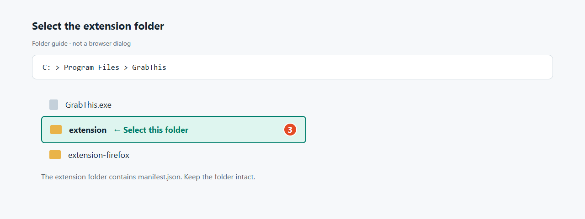

# Add GrabThis to your browser

Install the desktop app with **[GrabThis Setup.exe](https://github.com/Godchi872/GrabThis/releases/download/v0.1.45/GrabThis-0.1.45-Setup.exe)** first. Setup registers the local browser connection automatically.

On first launch, **Extension setup** opens automatically. Chrome, Edge and Brave share a five-step illustrated guide; Firefox has its own button opening the [Firefox Add-ons page](https://addons.mozilla.org/en-US/firefox/addon/grabthis-download-companion/). **Finish** closes the guide even while connection verification is pending. The reminder stays visible until a verified connection is completed; reopen the guide from the sidebar at any time.

Setup installs in **Program Files** and requests administrator approval for installation and updates. The app itself runs with normal user permissions. On the first launch after upgrading a previous per-user installation, GrabThis removes the old program while preserving user data and existing unpacked-extension folders.

Open **Start Menu → GrabThis → Browser extensions**. Copy the folder address from File Explorer; you will select this folder in step 3.

## Chromium browsers

Chrome, Edge, Brave, Opera / Opera GX and other compatible Chromium browsers use the same **extension** folder. Choose your browser’s address, then follow the highlighted screenshots immediately below.

### Open Extensions without typing an address

In Chrome, click the **three dots → Extensions → Manage extensions**. Other Chromium browsers may offer Extensions directly in their menu or under More tools.

This numbered menu image is an illustration. The following Developer mode and Load unpacked images are actual browser screenshots.

**Or copy the address for your browser:**

| Browser | Extensions page |
| --- | --- |
| Chrome | `chrome://extensions` |
| Microsoft Edge | `edge://extensions` |
| Brave | `brave://extensions` |
| Opera / Opera GX | `opera://extensions` |

Screenshots use Chrome. Labels and control positions can vary slightly between browsers.

### 1. Turn on Developer mode

Open the extensions page for your browser from the table above. Turn on **Developer mode**, outlined in orange in the screenshot.

### 2. Click Load unpacked

The button appears after Developer mode is enabled. Click the highlighted **Load unpacked** button.

### 3. Choose the extension folder

In the folder picker, select **extension** inside the installed GrabThis folder. You can paste the address copied from File Explorer. Select the folder itself; it contains **manifest.json**. Choose **extension**, rather than **extension-firefox** or the installer file.

This diagram identifies the folder to choose; it is not a screenshot of a browser dialog. A custom installation path may differ from the default shown.

### 4. Check that GrabThis is enabled

The **GrabThis Download Companion** card should appear with its switch on. Open the desktop app. The companion’s toolbar popup should show the desktop app as connected.

Allow site access for the websites you use. Private windows require a separate **Incognito / InPrivate / private-window** permission, where available, in the extension’s Details.

### Updating the extension

Install the updated GrabThis version, then click the circular **Reload** arrow inside its extension card and check the version. The page-wide Update button does not download new files for an unpacked extension.

## Firefox

Setup registers the Firefox native connection automatically. Open the [Firefox Add-ons page](https://addons.mozilla.org/en-US/firefox/addon/grabthis-download-companion/) from the app’s **Firefox Store** button and follow Mozilla’s installation prompt. Availability and approval are managed by Mozilla.

## Hide the floating button

Hover over GrabThis on a video and click **×**. The button stays hidden for that video until you refresh the page; other videos keep their buttons. Keyboard users can Tab to the close button and press Enter. No permanent site setting is changed.

## Troubleshooting

**Desktop app disconnected:** open GrabThis, rerun Setup.exe to repair the connection and reload the extension. Refresh an already-open video page if an old message remains.

**A file stays in the browser:** another download manager may intercept it first. POST, blob, protected/login-only and browser-only sessions may remain in the browser or be unavailable. Very fast Firefox files may finish before capture.

**A video has different qualities:** formats depend on the source. YouTube prepares the main video automatically; other sites inspect the selected video after you click the button.

## Français / العربية

The same illustrated guide is available on the localized website:

- [Français](https://grabthis.vercel.app/fr/#chrome-setup)
- [العربية](https://grabthis.vercel.app/ar/#chrome-setup)

Open the Chromium browser setup section to see the numbered images. The included **Browser setup guide** in GrabThis’s Start Menu folder also contains English, French and Arabic instructions.

Browser references: [Brave extension compatibility](https://support.brave.com/hc/en-us/articles/360017909112-How-can-I-add-extensions-to-Brave) · [Opera Developer mode and unpacked extensions](https://help.opera.com/en/extensions/testing/).
